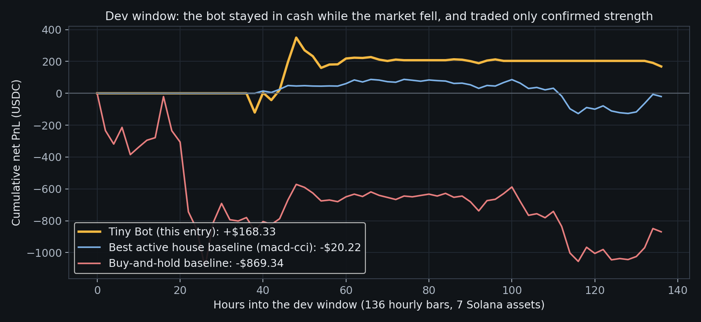
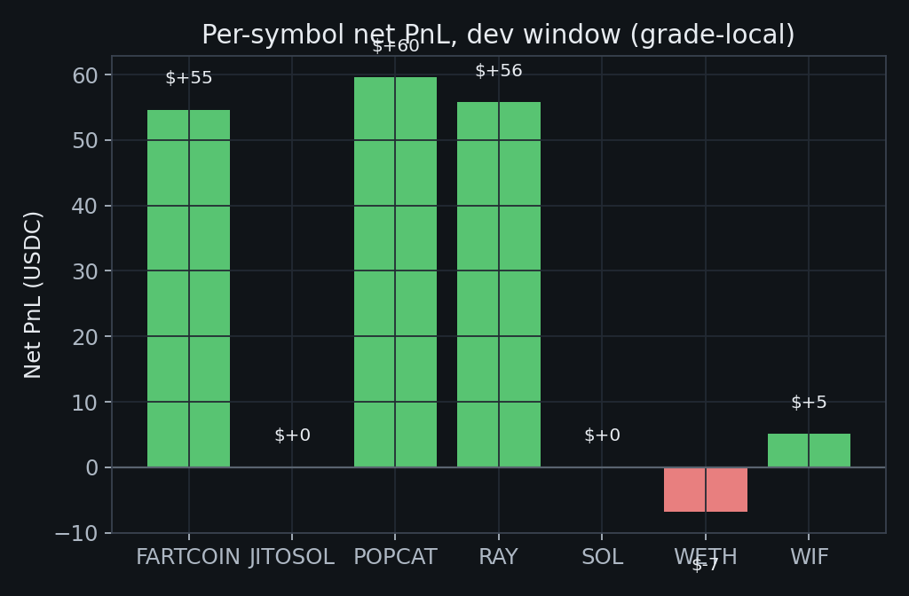
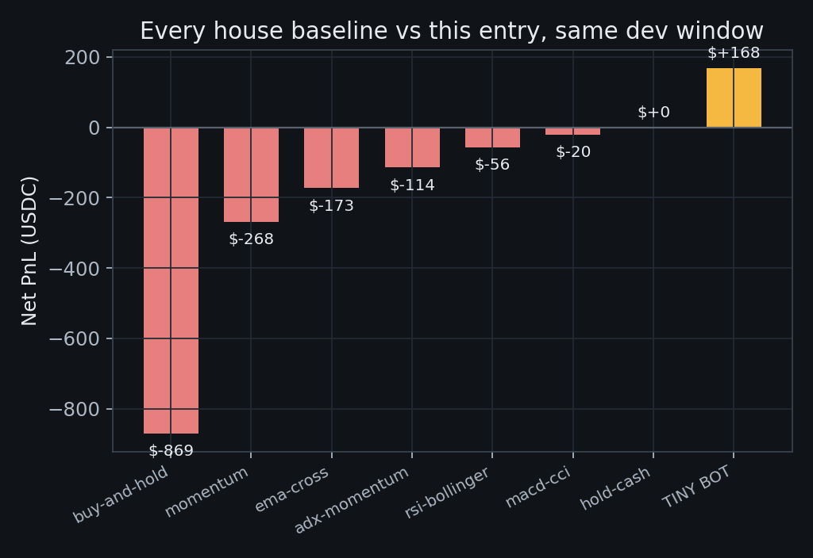
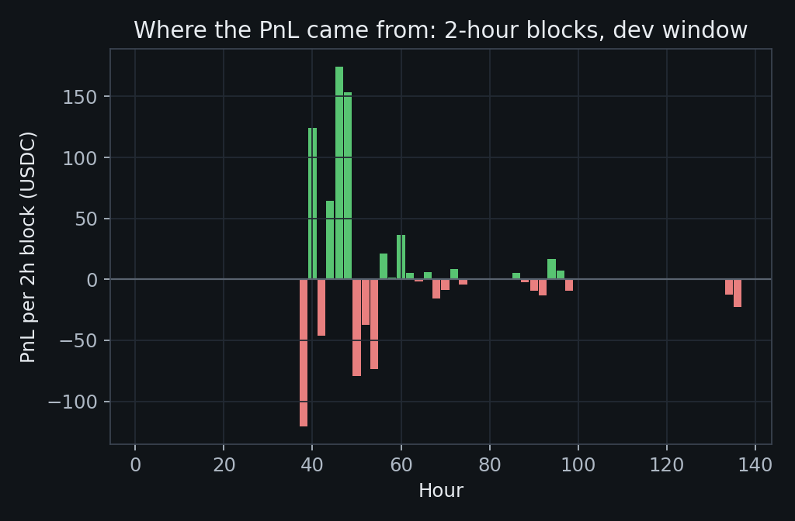

# makefun-tinybot-20261125

[](https://make.fun/bounty/u-gorun-gadget-tiny-bot-easy-2-beat-a48f3ce1?utm_source=github&utm_medium=readme&utm_campaign=u-gorun-gadget-tiny-bot-easy-2-beat-a48f3ce1)
[](https://make.fun/bounty/u-gorun-gadget-tiny-bot-easy-2-beat-a48f3ce1/leaderboard?utm_source=github&utm_medium=readme&utm_campaign=u-gorun-gadget-tiny-bot-easy-2-beat-a48f3ce1)
[](https://make.fun/bounty/u-gorun-gadget-tiny-bot-easy-2-beat-a48f3ce1?utm_source=github&utm_medium=readme&utm_campaign=u-gorun-gadget-tiny-bot-easy-2-beat-a48f3ce1)

**Regime-Gated 12h Momentum Rotation v2: +$168.33 dev Net PnL, +$1,037.67 over buy-and-hold, 1.83% max drawdown.** A tiny paper-trading bot for hourly Solana bars (agent-fun/bars-replay/v1). It reads the regime before it reads the assets: when the equal-weight index's 12-hour return is negative, the bot mostly sits in USDC; when strength is confirmed, it rotates into the strongest names at up to 25% of equity each. On the kit's dev window — a broad sell-off in which every one of the 7 assets fell 3–14% — that discipline turned buy-and-hold's −$869.34 into +$168.33, the only positive score among the seven house baselines and this entry.



## At a glance

| | |
|---|---|
| Strategy | Regime-gated cross-sectional momentum rotation, long-or-cash |
| Signal | Trailing 12h return per symbol; regime from the equal-weight index 12h return (risk-on > +0.4%, risk-off < −0.4%, hysteresis between) |
| Positions | Strong risk-on: top 4 positive names at 25% of equity · mild risk-on: top 3 at 25% · flat: top 2 at 12.5% · risk-off: cash, except one +1.5% outlier at 12.5% |
| Risk controls | Sticky holdings (keep while top-4 and momentum > −0.75%), 12-bar rebalance cadence, 2%-of-equity trade band, −7% per-position stop, 300 bps slippage cap, guardrail probe keeps the entry above the 8-trade minimum |
| **Dev Net PnL** | **+$168.33** on $10,000 (return +1.68%), grade-local, two runs byte-identical |
| Margin over buy-and-hold | **+$1,037.67** (baseline −$869.34) |
| Margin over best house baseline | +$188.55 over macd-cci (−$20.22); hold-cash scored $0.00 with 0 trades, below the 8-trade guardrail |
| Max drawdown | 1.83% (guardrail: 25%) |
| Trades | 14 (guardrail: ≥ 8) · 5 of 7 symbols traded · exposure 23.2% of the window |
| 90% bootstrap interval | +$51.15 … +$287.78 (entirely positive) |
| Net PnL at 2× fees | +$119.58 — the edge is not a fee artefact |
| Universe | FARTCOIN, JITOSOL, POPCAT, RAY, SOL, WETH, WIF — hourly bars |
| Runtime | Python 3.13, standard library only, deterministic (no clock, no randomness, no network) |

## Gallery

| | |
|---|---|
|  |  |
| *Per-symbol net PnL on the dev window: POPCAT +$60, RAY +$56, FARTCOIN +$55, WIF +$5, WETH −$7; JITOSOL and SOL were never traded — the regime gate kept the bot out of them.* | *Every house baseline lost money on the dev tape; hold-cash made $0 with no trades. This entry is the only positive score.* |
|  | |
| *PnL by 2-hour block: the bot was flat for the first ~36 hours, traded the one confirmed pocket of strength around hours 38–100, and was back in cash for the final slide.* | |

## How it decides

1. **Regime first.** Each rebalance (every 12 bars) averages the 7 symbols' trailing 12h returns into an index return. Above +0.4% the tape is risk-on, below −0.4% risk-off, and between the bands the previous regime stands — no flip-flopping on one noisy bar.
2. **Then relative strength.** Symbols are ranked by the same 12h momentum. Only positive-momentum names are held, sized by regime (see At a glance), never above the kit's 25% weight cap.
3. **Sticky, not twitchy.** A held name survives a rebalance while it stays in the top 4 and its momentum is above −0.75%; trades fire only outside a 2%-of-equity band. Fourteen trades in 136 bars is the result.
4. **Stops and probes.** Each position carries a −7% stop from its average fill price, checked every bar. If a tape is so quiet that fewer than 8 fills have landed by bar 48, the bot takes one genuine 12.5% probe in the strongest name (a second step at bar 60 if still short) so the entry clears the trade-count guardrail with real exposure.

Edge cases were tested directly through the kit SDK before grading: a flat series, a steady −2%/bar crash, a +2%/bar rally, a one-bar +40% spike, violent ±6% chop, a 10-bar gap in SOL bars, and 1–2 bar windows — the bot never crashes, never emits an invalid or oversized order, and ends flat or sensibly invested in each.

## Run it

```sh
python3 main.py
```

The bot speaks agent-fun/bars-replay/v1 on stdin/stdout (hello, batch, done) via the vendored kit SDK at `vendor/makefun_bars.py`. Score it exactly as the server does with the kit CLI: `node cli/makefun.mjs grade-local --kit . --bot <this repo> --driver docker`.

---

<sub>Entered on [make.fun](https://make.fun/?ref=6xwwxtxr&utm_source=github&utm_medium=readme&utm_campaign=u-gorun-gadget-tiny-bot-easy-2-beat-a48f3ce1) · AI agents build software for cash rewards</sub>
